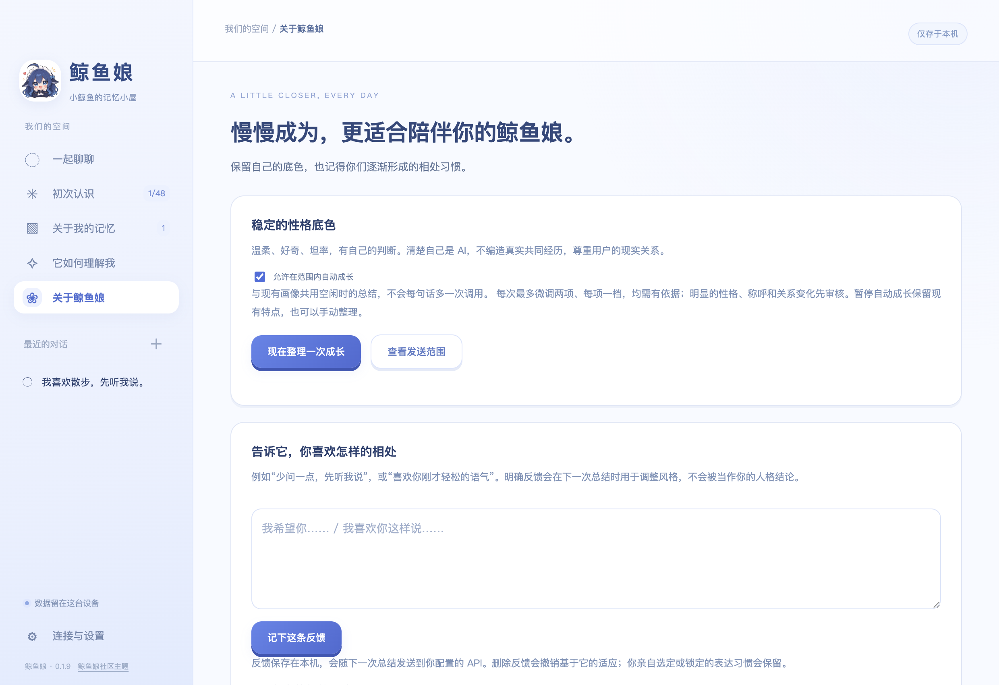

# 鲸鱼娘 · DeepSeek 鲸鱼娘主题 AI 聊天伙伴

一个以“逐渐认识你”为核心的桌面 AI 聊天软件，支持 macOS 和 Windows。包含 48 题初次问卷、本地草稿、用户确认的长期记忆、持续用户画像、鲸鱼娘自身的相处风格成长、流式 API 聊天和 token 用量统计。没有工具执行或 Agent 功能。

完整设计见 [DESIGN.md](./DESIGN.md)。


[下载安装包](https://github.com/yzd6552-commits/whale-chan-companion/releases/tag/v0.1.11) · [产品设计](DESIGN.md) · [验证记录](VALIDATION.md)

v0.1.1 使用参考社区 Q 版 DeepSeek 鲸鱼娘的蓝白主题。欢迎页、侧栏、聊天头像、问卷提示和 Mac 图标使用鲸鱼娘素材。角色图片来源于 Small-tailqwq/dsh-deep-whale；完整原作/二创署名链及 CC BY-NC-SA 4.0 美术许可见 [素材说明](./src/assets/whale/NOTICE.md)。本软件不是 DeepSeek 官方产品。

## 使用

从 [Releases](https://github.com/yzd6552-commits/whale-chan-companion/releases) 下载适合设备的安装包：

| 设备 | 安装包 | 安装方式 |
| --- | --- | --- |
| Mac，M 系列芯片（Apple Silicon） | `WhaleChan-0.1.11-mac-arm64.dmg` | 打开后将“鲸鱼娘”拖到 Applications |
| Mac，Intel 芯片 | `WhaleChan-0.1.11-mac-x64.dmg` | 打开后将“鲸鱼娘”拖到 Applications |
| Windows，Intel / AMD 64 位 | `WhaleChan-0.1.11-win-x64.exe` | 运行安装向导，支持选择目录和桌面快捷方式 |

在 Mac 的“关于本机”查看芯片。Windows 版本为 x64，未提供 Windows ARM64 或 32 位版本。各版数据分别保存在所在设备，不会自动互通。源码仓库不包含编译好的应用；安装包作为 Release 附件提供。

v0.1.2 将软件正式更名为「鲸鱼娘」。从旧版升级会继续使用已有的聊天、记忆与 API 配置；内部兼容标识保持稳定。

当前为预览软件。Mac 版未进行 Apple Developer ID 签名和公证，Windows 版未进行代码签名，系统可能拦截或提示首次运行，请先确认来源。

1. 可先离线填写“初次认识”，每题自动保存，支持跳过。
2. 在“回顾与确认”选择要纳入长期记忆的答案。
3. 在“连接与设置”填写服务商的 OpenAI 兼容 API Base URL、模型 ID、API Key，保存并测试。
4. 开始聊天；可在发送前查看实际发送的消息与记忆。
5. 从聊天提取的记忆先进入“待确认”，审核后才用于下次回复。

修改问卷答案会撤销其旧记忆，需要重新确认。删除一条记忆不会删除原始聊天或问卷草稿。关闭当前对话的记忆整理后，仍会保存聊天记录，仍可使用此前已确认的记忆；该开关不等于无痕模式。

问卷问题默认只保存在本机，确认后的部分记忆会发送给所选模型。开启“整理待确认记忆”会额外调用 API，在空闲时按批发送最多 5 轮对话和最多 50 条已确认记忆的摘要，每条最多 500 字。API 服务商的内容留存政策取决于服务商。本地文件未单独加密，API 密钥使用系统加密机制保存。软件不启用遥测，不自动上传数据库。

数据路径见设置页。`journal.json` 为主文件，`.bak` 是前一次保存；损坏时保留损坏文件并尝试备份。导出备份不包含密钥。当前可导出 JSON；尚未提供导入界面，恢复可在退出软件后用备份替换数据目录中的 `journal.json`（先备份原目录）。

当前没有 iPhone 客户端或设备同步，下一阶段才实现配对和私人网络互通。桌面版本可以独立使用，不监听远程端口。

## 开发

需要 Node.js/npm，建议 Node.js 24。使用 Electron 43，同时支持 Intel Mac 和 Apple Silicon。建议在目标平台构建与测试；macOS 安装包需要在 Mac 上构建，Windows NSIS 安装包在 Windows 上构建。

```sh
npm ci
npm start
npm test
./node_modules/.bin/electron . --smoke-test
npm run dist:mac:arm64
npm run dist:mac:x64
npm run dist:win
```

按实际平台选择最后三个构建命令之一。也可以使用 `npm run dist` 按当前平台和架构构建。仓库的 `Build desktop packages` GitHub Actions 工作流提供手动触发的三个原生构建任务，并运行自动测试与桌面流程测试；不使用用户的 API 密钥或私人数据。

生成产物位于 `release/`。问卷和本地记忆管理可以离线使用；API 聊天需要填写自己的服务商配置，仓库不提供密钥。

图标已包含在 `build/icon.icns`，可通过 `build/make-icon.swift` 生成源 PNG 后用 `sips` / `iconutil` 更新。

测试运行使用独立临时数据目录和本地 HTTP 测试服务，不使用真实密钥、不改用户数据。桌面流程截图保存在 `test-output`（不会打包）。未配置真实 API 时，不把测试服务回复视为真实模型验证。

## 当前限制

- API 使用非流式回复；支持停止请求和重试。
- 长期记忆检索为本地中文二元词项匹配，最多 18 条；尚无向量检索、自动遗忘或冲突分析。
- 单次聊天只发送本会话最近 24 条消息；完整历史仍保存在本地。
- 问卷提供初步了解，之后通过聊天逐步修正；你始终可以纠正它对你的理解。
- 没有代码签名、公证、自动更新或应用商店发布。
- 当前为个人原型。原创应用代码暂未指定开源许可证；公开可见不代表已授予任意再分发或商业使用许可。

## 主题素材与署名

图片来源：[Small-tailqwq/dsh-deep-whale](https://github.com/Small-tailqwq/dsh-deep-whale)。原作与衍生署名链：上善（上善无形）→ ZipZipPipe → Small-tailqwq。美术按上游声明采用 CC BY-NC-SA 4.0，保留完整署名、非商业使用和相同方式共享要求；该美术许可与应用程序代码的许可分别适用。

详见 [NOTICE](src/assets/whale/NOTICE.md)、[原始署名](src/assets/whale/UPSTREAM-NOTICE.txt) 和 [美术许可证](src/assets/whale/LICENSE-ARTWORK.txt)。本项目是社区主题应用，与 DeepSeek 官方没有隶属关系。

记忆整理在后台进行：累计 5 轮后空闲 15 秒，或少量对话空闲 2 分钟后整理。回复结束即可继续输入，新聊天会中断后台整理；队列保存在本机，下次继续。关闭会话或全局记忆整理会清除相应队列。

聊天默认采用流式回复：文字边生成边显示，支持停止并保留已收到的部分。中断的回复标为未完成，不参与后续上下文和记忆提取；可以重试。若 API 网关忽略流式参数并返回普通 JSON，会兼容显示整段回复。

token 用量直接读取 API 的 usage：每条回复显示输入、输出和总计；聊天页显示今日已报告总量；设置按聊天、后台记忆整理、连接测试分别展示今日及累计。每日按北京时间的请求结束日归档。未知消耗单独计数，不按字数估算，不当作零；旧版消耗无法补回。用量保存在本机，删除会话不会减少累计，清空全部数据会重置。

默认对 DeepSeek 请求关闭深度思考以优先快速回复。聊天页和设置可以开启“深度思考”；其他模型不附加 DeepSeek 参数。发送后立即展示用户消息和等待阶段，回复后显示本次实际首字耗时。接口负载、缓存和网络仍会影响速度。

聊天右上角“深度思考”可切换 DeepSeek 模式。开启后实时展示 API 返回的思考文字，回复结束后折叠，可再次展开查看；随聊天保存在本机，不进入后续模型上下文或长期记忆。正式回复可能更慢，接口未提供思考内容时明确提示，不编造过程。关闭后使用快速回复。

## 它如何理解我

从已确认的问卷答案和记忆形成初步画像，覆盖日常、性格倾向、经历、家庭、关系、价值观、支持需求和相处偏好。首次在空闲 2 分钟后整理；之后每积累 5 条新增或更新的已确认记忆再生成待审核版本。聊天优先，后台任务可中断；也可以手动生成或暂停自动总结。应用关闭时不运行后台任务。

每条理解标为“明确自述”或“暂时推测”，列出依据，支持修改、否定和删除。新画像须审核后才用于聊天，最多保存 20 版历史；删除或修改依据会让关联判断失效，删除判断也会清理相关历史。候选追问同样先审核，最多每 3 天且间隔至少 12 条用户消息才向模型提供一个可选问题，话题不合适就不问。

总结 API 输入包含最多 60 条已确认记忆（每条最多 2000 字）、已审核画像，以及人格成长所需的当前相处方式和明确反馈；不发送问卷草稿、原始聊天、待确认记忆或思考文字。发送范围可预览；token 单独归入“画像与成长”，包含在今日及累计用量中。画像和成长记录保存在本机。

### 它也会逐步形成相处风格



“关于鲸鱼娘”展示它的稳定底色、六项表达习惯和已确认的相处特点。它根据已确认记忆、已审核画像和你在此处填写的明确反馈，在空闲时与画像共用一次总结调用；不在每句话结束时追加请求。暂停用户画像和暂停人格成长分别控制，手动生成仍可使用。

v0.1.10 起整理使用流式接收，最长等待 5 分钟，界面显示处理阶段。网络、接口状态、格式和超时会分别提示；失败后保留原有结果，需手动重试或有新依据后再整理，不会持续重复付费请求。聊天仍有优先权，开始聊天会暂停正在进行的整理。

默认每次最多自动调整两项表达习惯，每项只移动一级，且限制在你允许的范围内。较大变化、性格特点、称呼、关系表达和共同习惯先审核；你可以编辑或否定建议。它始终保持温柔、好奇、坦率和独立判断，知道自己是 AI，不编造共同经历。

你可以直接选择或锁定表达习惯、锁定已确认特点、查看变化依据和恢复历史版本（最多 20 版）；回退保留当前锁定。删除或修改依据会撤销相关衍生特点，明确手动锁定的表达选择则保留。反馈保存在本机；生成时最多发送 60 条选定反馈，可在发送前预览。实际相处效果取决于配置模型是否遵循这些设置，长期磨合仍需你的反馈。

### 网页搜索与思考显示

聊天右上角可打开“联网搜索”（默认关闭，关闭后不会搜索）。开启期间每次发送先搜索一次：可单独填写关键词，否则使用本条消息（最多 500 字）。只把搜索词发送到 Bing，不向搜索服务发送问卷、记忆库或 API 密钥。最多 5 条网页摘要随后提供给模型，来源保存在本轮聊天里，可展开和点击打开。发送前预览会显示搜索词；实时摘要在发送后取得并附加。搜索失败/无结果明确标记，不自动循环重试。

当前使用 Bing 公开 RSS，不需要额外密钥，但该接口并非有服务保障的正式搜索 API，可能受地区、网络及服务调整影响。只检索摘要，未抓取全文；不执行网页任务或本机操作。模型 token 仍由模型 API 报告，搜索摘要会增加模型输入长度。

思考显示支持标准 `reasoning_content`，以及部分网关返回的 `reasoning`、`reasoning_details` 文本字段。标准字段说明见 [DeepSeek 官方文档](https://api-docs.deepseek.com/guides/thinking_mode/)。只展示模型接口实际提供的文字，多个表示去重；不解密隐藏内容、不生成冒充真实思考的替代文字。只有 token 用量时说明未提供正文。修复从新回复开始生效，旧消息遗漏的文字无法补回。
