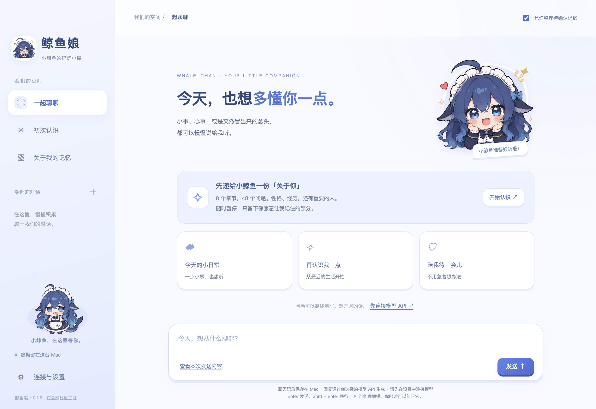

# 鲸鱼娘 · DeepSeek 鲸鱼娘主题 AI 聊天伙伴

一个以“逐渐认识你”为核心的桌面 AI 聊天软件，支持 macOS 和 Windows。包含 48 题初次问卷、本地草稿、用户确认的长期记忆、模型 API 聊天与待确认记忆审核。没有工具执行或 Agent 功能。

完整设计见 [DESIGN.md](./DESIGN.md)。



[下载安装包](https://github.com/yzd6552-commits/whale-chan-companion/releases/tag/v0.1.4) · [产品设计](DESIGN.md) · [验证记录](VALIDATION.md)

v0.1.1 使用参考社区 Q 版 DeepSeek 鲸鱼娘的蓝白主题。欢迎页、侧栏、聊天头像、问卷提示和 Mac 图标使用鲸鱼娘素材。角色图片来源于 Small-tailqwq/dsh-deep-whale；完整原作/二创署名链及 CC BY-NC-SA 4.0 美术许可见 [素材说明](./src/assets/whale/NOTICE.md)。本软件不是 DeepSeek 官方产品。

## 使用

从 [Releases](https://github.com/yzd6552-commits/whale-chan-companion/releases) 下载适合设备的安装包：

| 设备 | 安装包 | 安装方式 |
| --- | --- | --- |
| Mac，M 系列芯片（Apple Silicon） | `WhaleChan-0.1.4-mac-arm64.dmg` | 打开后将“鲸鱼娘”拖到 Applications |
| Mac，Intel 芯片 | `WhaleChan-0.1.4-mac-x64.dmg` | 打开后将“鲸鱼娘”拖到 Applications |
| Windows，Intel / AMD 64 位 | `WhaleChan-0.1.4-win-x64.exe` | 运行安装向导，支持选择目录和桌面快捷方式 |

在 Mac 的“关于本机”查看芯片。Windows 版本为 x64，未提供 Windows ARM64 或 32 位版本。各版数据分别保存在所在设备，不会自动互通。源码仓库不包含编译好的应用；安装包作为 Release 附件提供。

v0.1.2 将软件正式更名为「鲸鱼娘」。从旧版升级会继续使用已有的聊天、记忆与 API 配置；内部兼容标识保持稳定。

当前为预览软件。Mac 版未进行 Apple Developer ID 签名和公证，Windows 版未进行代码签名，系统可能拦截或提示首次运行，请先确认来源。

1. 可先离线填写“初次认识”，每题自动保存，支持跳过。
2. 在“回顾与确认”选择要纳入长期记忆的答案。
3. 在“连接与设置”填写服务商的 OpenAI 兼容 API Base URL、模型 ID、API Key，保存并测试。
4. 开始聊天；可在发送前查看实际发送的消息与记忆。
5. 从聊天提取的记忆先进入“待确认”，审核后才用于下次回复。

修改问卷答案会撤销其旧记忆，需要重新确认。删除一条记忆不会删除原始聊天或问卷草稿。关闭当前对话的记忆整理后，仍会保存聊天记录，仍可使用此前已确认的记忆；该开关不等于无痕模式。

问卷问题默认只保存在本机，确认后的部分记忆会发送给所选模型。开启“整理待确认记忆”会额外调用 API，在空闲时按批发送最多 5 轮对话和最多 50 条已确认记忆的摘要，每条最多 500 字。API 服务商的内容留存政策取决于服务商。本地文件未单独加密，API 密钥使用系统加密机制保存。软件不启用遥测，不自动上传数据库。

数据路径见设置页。`journal.json` 为主文件，`.bak` 是前一次保存；损坏时保留损坏文件并尝试备份。导出备份不包含密钥。当前可导出 JSON；尚未提供导入界面，恢复可在退出软件后用备份替换数据目录中的 `journal.json`（先备份原目录）。

当前没有 iPhone 客户端或设备同步，下一阶段才实现配对和私人网络互通。桌面版本可以独立使用，不监听远程端口。

## 开发

需要 Node.js/npm，建议 Node.js 24。使用 Electron 43，同时支持 Intel Mac 和 Apple Silicon。建议在目标平台构建与测试；macOS 安装包需要在 Mac 上构建，Windows NSIS 安装包在 Windows 上构建。

```sh
npm ci
npm start
npm test
./node_modules/.bin/electron . --smoke-test
npm run dist:mac:arm64
npm run dist:mac:x64
npm run dist:win
```

按实际平台选择最后三个构建命令之一。也可以使用 `npm run dist` 按当前平台和架构构建。仓库的 `Build desktop packages` GitHub Actions 工作流提供手动触发的三个原生构建任务，并运行自动测试与桌面流程测试；不使用用户的 API 密钥或私人数据。

生成产物位于 `release/`。问卷和本地记忆管理可以离线使用；API 聊天需要填写自己的服务商配置，仓库不提供密钥。

图标已包含在 `build/icon.icns`，可通过 `build/make-icon.swift` 生成源 PNG 后用 `sips` / `iconutil` 更新。

测试运行使用独立临时数据目录和本地 HTTP 测试服务，不使用真实密钥、不改用户数据。桌面流程截图保存在 `test-output`（不会打包）。未配置真实 API 时，不把测试服务回复视为真实模型验证。

## 当前限制

- API 使用非流式回复；支持停止请求和重试。
- 长期记忆检索为本地中文二元词项匹配，最多 18 条；尚无向量检索、自动遗忘或冲突分析。
- 单次聊天只发送本会话最近 24 条消息；完整历史仍保存在本地。
- 当前没有后台自动总结人格，也不保证一次问卷能准确理解一个人。
- 没有代码签名、公证、自动更新或应用商店发布。
- 当前为个人原型。原创应用代码暂未指定开源许可证；公开可见不代表已授予任意再分发或商业使用许可。

## 主题素材与署名

图片来源：[Small-tailqwq/dsh-deep-whale](https://github.com/Small-tailqwq/dsh-deep-whale)。原作与衍生署名链：上善（上善无形）→ ZipZipPipe → Small-tailqwq。美术按上游声明采用 CC BY-NC-SA 4.0，保留完整署名、非商业使用和相同方式共享要求；该美术许可与应用程序代码的许可分别适用。

详见 [NOTICE](src/assets/whale/NOTICE.md)、[原始署名](src/assets/whale/UPSTREAM-NOTICE.txt) 和 [美术许可证](src/assets/whale/LICENSE-ARTWORK.txt)。本项目是社区主题应用，与 DeepSeek 官方没有隶属关系。

记忆整理在后台进行：累计 5 轮后空闲 15 秒，或少量对话空闲 2 分钟后整理。回复结束即可继续输入，新聊天会中断后台整理；队列保存在本机，下次继续。关闭会话或全局记忆整理会清除相应队列。
